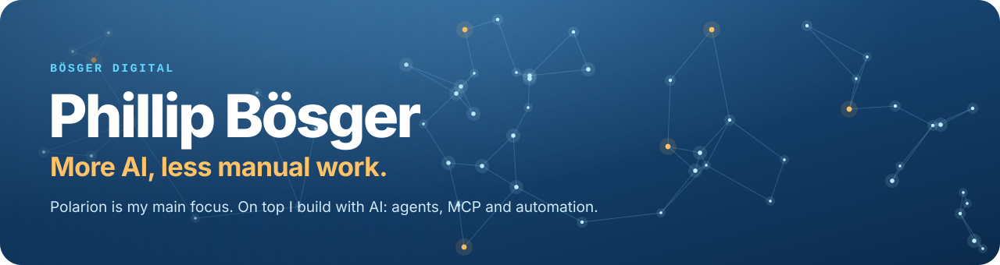
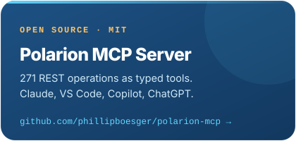
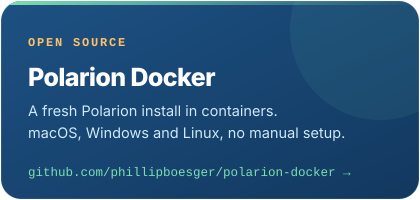
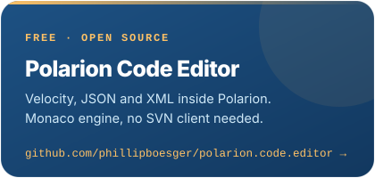

  

  
  
  
  
  

  Freelance since January 2026. 8 years of Polarion, from Siemens enterprise to startup, where requirements management meets technical execution.

---

### What I do

<table>
  <tr>
    <td width="50%" valign="top">
      <b>Polarion, from spec to production</b> 
      Extensions in Java, REST, Velocity and workflow scripts, with CI/CD and automated release documentation.
    </td>
    <td width="50%" valign="top">
      <b>AI agents and MCP</b> 
      Agents that work on real Polarion data instead of copy and paste.
    </td>
  </tr>
  <tr>
    <td valign="top">
      <b>AI enablement</b> 
      Coaching on real tickets, so teams use Copilot and agents properly.
    </td>
    <td valign="top">
      <b>Sharing what works</b> 
      Tools, guides and write-ups other teams can reuse.
    </td>
  </tr>
</table>

### Open source

<table>
  <tr>
    <td align="center" width="33%">
       
      
    </td>
    <td align="center" width="33%">
       
      
    </td>
    <td align="center" width="33%">
       
      
    </td>
  </tr>
</table>

  &nbsp;&nbsp;
  

Tell me where your team is losing time: <a href="mailto:digital@boesger.com">digital@boesger.com</a>

